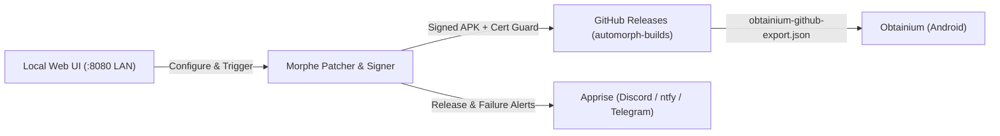

<div align="center">
  
  <h1>AutoMorph (GitHub Releases &amp; Obtainium Fork)</h1>
  <p>Automated Android APK patching &amp; distribution orchestrator powered by <strong>Morphe Desktop</strong>.<br>Keep your Web UI strictly local/LAN-only while publishing signed APKs to <strong>GitHub Releases</strong> for seamless <strong>Obtainium</strong> updates.</p>

  <p>
    <a href="https://github.com/holjab/AutoMorph"></a>
    
    
    
    
  </p>
</div>

---

## Credits & Fork Attribution

- **Original Creator & Upstream Project:** Full credit goes to **[holjab](https://github.com/holjab)** and **[holjab/AutoMorph](https://github.com/holjab/AutoMorph)** for AutoMorph's core patching pipeline, APK fetcher, web control center, and scheduler.
- **Core Ecosystem:** **[Morphe Desktop](https://github.com/MorpheApp/morphe-desktop)** (patching engine), **[Obtainium](https://github.com/ImranR98/Obtainium)** (Android update client), and **[goopdl](https://github.com/Villoh/goopdl)** (Google Play downloader).
- **About This AI-Assisted Fork:** The GitHub Releases publisher (`scripts/github_release.py`), Obtainium GitHub exporter, signing certificate guard, release diffs, live builds dashboard, `CHANGELOG.md` & `catalog.json` generators, Apprise alerts, Portainer stack, and upstream-sync workflow were built by **LoginRs99** as an **AI-assisted fork** with AI coding and architectural orchestration.

---

## Architecture & Distribution Modes



| Capability | Fork Mode (Recommended) | Upstream Tunnel Mode |
| --- | --- | --- |
| **Web UI Exposure** | Strictly LAN / Tailscale IP (`:8080`) | Public HTTPS tunnel (Cloudflare / Pangolin / Tailscale Funnel) |
| **APK Delivery** | GitHub Releases (`<slug>-v<version>`) | Local `/files/...` + `/index-v2.json` |
| **Obtainium Sync** | `automorph-config` release (`obtainium-github-export.json`) | Built-in `/automorph-obtainium.json` |
| **Notifications** | Apprise (Discord, ntfy, Telegram, etc.) + optional Email | Email (SMTP) |
| **Compose File** | [`portainer-compose.yaml`](portainer-compose.yaml) / [`default_compose.yaml`](default_compose.yaml) | [`default_compose.yaml`](default_compose.yaml) |

---

## Step-by-Step Setup Guide

### 1. Create Your Builds Repository & Fine-Grained PAT

1. Create a GitHub repository to host your patched APKs (e.g., `LoginRs99/automorph-builds`).
   - **Public repo:** Zero-auth downloads for family and multi-device Obtainium imports.
   - **Private repo:** Works identically; each Obtainium client just needs a read-only GitHub PAT.
2. Create a **Fine-Grained Personal Access Token** (`github_pat_...`):

> [!IMPORTANT]
> Under **Repository access**, choose **Only select repositories** → select your builds repo (`automorph-builds`), and grant **Contents: Read and write** and **Metadata: Read-only**.

### 2. Build & Publish the Fork Image (GHCR)

1. Enable **GitHub Actions** on your forked `AutoMorph` repository.
2. Push to `main` (or run [`.github/workflows/docker-publish.yaml`](.github/workflows/docker-publish.yaml) manually) to publish `ghcr.io/loginrs99/automorph:latest` (replace `loginrs99` with your username if using your own fork).

> [!NOTE]
> Docker Hub login is automatically skipped when `DOCKERHUB_USERNAME` / `DOCKERHUB_TOKEN` secrets are unset. Ensure your GHCR package visibility is **Public** (or linked to the repo) so Portainer/Docker can pull it.

### 3. Deploy with Portainer or Docker Compose

**Option A — Portainer Stacks ([`portainer-compose.yaml`](portainer-compose.yaml)):**
1. Create host directories:
   ```bash
   sudo mkdir -p /opt/automorph/apps /opt/automorph/tools/morphe-data /opt/automorph/tools/automorph-data
   ```
2. In **Portainer → Stacks → Add stack**, paste [`portainer-compose.yaml`](portainer-compose.yaml) (optionally bind `ports:` to your LAN IP, e.g., `192.168.1.100:8080:8080`).
3. Upload [`example.env`](example.env) or paste variables into Portainer's **Environment variables** UI, then deploy.

**Option B — Docker Compose ([`default_compose.yaml`](default_compose.yaml)):**
```bash
cp example.env .env   # Fill in GITHUB_RELEASE_REPO, GITHUB_RELEASE_TOKEN, etc.
docker compose -f default_compose.yaml pull && docker compose -f default_compose.yaml up -d
```

### 4. First-Run Visual Patch Setup

1. Open `http://<server-lan-ip>:8080`, add your target apps, toggle desired patches once, and trigger a build.
2. *(Optional)* Set `GITHUB_RELEASE_SYNC_ALL=true` for one run if you already have previously patched APKs in `patched.json` to catch up.

### 5. Import into Obtainium (Your Phone & Family)

1. In **Obtainium → Import/Export → Obtainium Import**, paste:
   ```text
   https://github.com/<owner>/<builds-repo>/releases/download/automorph-config/obtainium-github-export.json
   ```
2. *(Private repo only)* Add a read-only GitHub PAT under **Obtainium → Settings → GitHub Personal Access Token**.

> [!TIP]
> Each app in `obtainium-github-export.json` has **Verify Latest Tag: OFF** (`verifyLatestTag: false`) and per-app slug filters (`^<slug>-v` and `^<slug>-.*\.apk$`, e.g. `^tiktok-v`) so multiple apps in one repository never collide.

---

## Fork Features & Safeguards

- **Signing Certificate Fingerprint Guard:** Parses the APK Signature Scheme v2/v3 block (`APK Sig Block 42`) and hashes the X.509 DER certificate before uploading. Mismatches abort the upload to prevent `INSTALL_FAILED_UPDATE_INCOMPATIBLE` (override once with `ALLOW_CERT_CHANGE=true`).
- **"What Changed" Release Diffs & Live Builds Dashboard:** Same-version rebuilds update the release notes (`PATCH`) with version transitions and `+ / -` patch diffs. `publish_repo_readme` maintains a scannable builds table + expandable `<details>` cards in `automorph-builds/README.md`, alongside rolling `CHANGELOG.md` and `catalog.json`.
- **Apprise Notifications & Failure Alerts:** `APPRISE_URL` sends detailed alerts for single-app releases and compact multi-app digests when multiple apps release together, plus failure/cert-mismatch alerts (`APPRISE_NOTIFY_ON_FAILURE=true`).
- **Automated Upstream Sync:** [`.github/workflows/upstream-sync.yaml`](.github/workflows/upstream-sync.yaml) runs weekly (and via `workflow_dispatch`) to merge `holjab/AutoMorph` (`main`) into a `sync/upstream-main` PR.

---

## Reference & Upstream Documentation

<details>
<summary><strong>Environment Variables Reference (All 25 Variables)</strong></summary>

| Variable | Default | Description | Example |
| --- | --- | --- | --- |
| `GITHUB_RELEASE_REPO` | *(empty / disabled)* | Target `owner/repo` for APK releases | `LoginRs99/automorph-builds` |
| `GITHUB_RELEASE_TOKEN` | *(falls back to `GITHUB_TOKEN`)* | Fine-grained PAT (`Contents: Read and write`) | `github_pat_...` |
| `GITHUB_RELEASE_KEEP` | `1` | Max releases kept per package (`<= 0` disables pruning) | `1` |
| `GITHUB_RELEASE_PUBLISH_CONFIG` | `true` | Upload `obtainium-github-export.json` to `automorph-config` | `true` |
| `GITHUB_RELEASE_EXCLUDE` | *(empty)* | Comma-separated packages omitted from Obtainium export | `com.example.private` |
| `GITHUB_RELEASE_SYNC_ALL` | `false` | Catch up un-published latest versions in `patched.json` | `false` |
| `FORCE_GITHUB_RELEASE` | `false` | Re-upload even if SHA-256 matches `github_releases.json` | `false` |
| `GITHUB_RELEASE_UPDATE_README` | `true` | Auto-update `README.md` dashboard in builds repo | `true` |
| `GITHUB_RELEASE_UPDATE_CHANGELOG` | `true` | Auto-update rolling `CHANGELOG.md` in builds repo | `true` |
| `GITHUB_RELEASE_UPDATE_CATALOG` | `true` | Auto-update `catalog.json` in builds repo | `true` |
| `ALLOW_CERT_CHANGE` | `false` | Allow upload if APK signing certificate SHA-256 changed | `false` |
| `APPRISE_URL` | *(empty / disabled)* | Space/comma-separated Apprise notification URL(s) | `ntfy://topic discord://id/tok` |
| `APPRISE_NOTIFY_ON_FAILURE` | `true` | Send Apprise alert on build failures or cert mismatches | `true` |
| `GITHUB_TOKEN` | *(empty)* | Optional PAT for upstream patch repo queries / fallback | `ghp_...` |
| `GOOPDL_ACCOUNT_EMAIL` | *(empty)* | Disposable Google account email for Play Store downloads | `burner@gmail.com` |
| `GOOPDL_AAS_TOKEN` | *(empty)* | AAS token for `goopdl` Play Store authentication | `aas_et/...` |
| `SMTP_USERNAME` | *(empty)* | SMTP username for optional email build reports | `user@gmail.com` |
| `SMTP_PASSWORD` | *(empty)* | SMTP password / App Password for email reports | `abcd efgh ijkl mnop` |
| `BASE_URL` | *(empty)* | Optional external/LAN URL for built-in Obtainium/F-Droid feeds | `http://192.168.1.100:8080` |
| `COMPOSE_PROFILES` | *(empty)* | Optional tunnel profiles (`cloudflare`, `pangolin`, `tailscale`) | `cloudflare` |
| `CLOUDFLARE_TUNNEL_TOKEN` | *(empty)* | Cloudflare Tunnel token (when using `cloudflare` profile) | `eyJ...` |
| `CLOUDFLARE_TUNNEL_URL` | *(empty)* | Public Cloudflare Tunnel URL | `https://automorph.example.com` |
| `PANGOLIN_ENDPOINT` | *(empty)* | Pangolin Newt endpoint | `https://pangolin.example.com` |
| `PANGOLIN_ID` | *(empty)* | Pangolin Newt ID | `...` |
| `PANGOLIN_SECRET` | *(empty)* | Pangolin Newt secret | `...` |
| `PANGOLIN_URL` | *(empty)* | Public Pangolin URL | `https://automorph.example.com` |
| `TAILSCALE_FUNNEL_URL` | *(empty)* | Public Tailscale Funnel URL | `https://node.tailnet.ts.net` |

</details>

<details>
<summary><strong>Upstream Key Features &amp; Screenshots</strong></summary>

- **Automated repo tracking:** Monitors patch repositories for updates.
- **Automatic APK downloads:** Prioritises Google Play and falls back to APKCombo, Uptodown, and APKPure.
- **Email notifications and web portal:** Optional SMTP email alerts and local web control center.
- **Optional Obtainium & F-Droid sync:** Built-in Obtainium export and F-Droid v2 repository feed.
- **Scheduled or manual builds:** Daily cron schedule or on-demand builds from the web UI.
- **Free hosting:** Runs on Oracle Cloud Free Tier or any local Docker host.

#### Control Center & Dashboard


#### Add Package Wizard


#### Settings & Tunnels


</details>

<details>
<summary><strong>Upstream Documentation Links</strong></summary>

For full step-by-step upstream guides, visit the **[Documentation Hub](docs/README.md)**:

- ☁️ **[Oracle Free Tier Setup Guide (Optional)](docs/oracle-setup.md)** — Launch a free VPS on Oracle Cloud.
- 🚇 **[Remote Access & Tunnels Guide](docs/tunnels.md)** — Expose your portal via Pangolin, Tailscale Funnel, or Cloudflare Tunnels.
- 📖 **[User Guide & Web Interface](docs/user-guide.md)** — Managing packages, patch options, schedules, Obtainium / F-Droid sync, and email notifications.

</details>

## Disclaimer

AutoMorph is provided as-is for educational and personal use. Ensure you comply with the terms of service of any app stores, patch repositories, and services you interact with.
